# Stationsgraph (generiert)

Automatisch aus `data/` erzeugt mit `npm run graph -- --write`. Nicht von Hand bearbeiten.
Gestrichelte Kanten haben eine Bedingung, Aktionen (↺) sind nicht eingezeichnet. Die globalen Enden (Schneeschlaf, Zu spät) sind von jeder Station aus erreichbar.

```mermaid
flowchart TD
    classDef ende fill:#2b1d3a,stroke:#e8c66a,color:#fff
    classDef start fill:#1d3a2b,stroke:#e8c66a,color:#fff

    subgraph ankunft["Ankunft"]
        bahnhof(["bahnhof"]):::start
        waerterhaus["waerterhaus"]
        dorfweg["dorfweg"]
    end

    subgraph haus["Omas Haus"]
        omas_haus["omas_haus"]
        stube["stube"]
        omas_brief["omas_brief"]
        kueche["kueche"]
        dachboden["dachboden"]
        dachboden_truhe["dachboden_truhe"]
        dachboden_wichtel["dachboden_wichtel"]
        adventskalender["adventskalender"]
        tuer_24["tuer_24"]
    end

    subgraph dorf["Dorfplatz"]
        dorfplatz["dorfplatz"]
        agathe["agathe"]
    end

    subgraph kirche["Kirche"]
        kirche_vorplatz["kirche_vorplatz"]
        kirchenschiff["kirchenschiff"]
        anselm["anselm"]
        krippe["krippe"]
    end

    subgraph muehle["Mühle"]
        muehlweg["muehlweg"]
        eis_bricht["eis_bricht"]
        muehle_aussen["muehle_aussen"]
        muehle_fenster["muehle_fenster"]
        muehle_innen["muehle_innen"]
        wichtelrat["wichtelrat"]
        mahlwerk["mahlwerk"]
        geheimgang["geheimgang"]
    end

    subgraph wald["Wald"]
        waldrand["waldrand"]
        wald_dunkel["wald_dunkel"]
        lichtung_fuchs["lichtung_fuchs"]
        koehlerhuette["koehlerhuette"]
        holzhacken["holzhacken"]
        eissee_ufer["eissee_ufer"]
        webstuhl["webstuhl"]
        schneeweber_gespraech["schneeweber_gespraech"]
    end

    subgraph turm["Glockenturm"]
        turmtreppe["turmtreppe"]
        glockenstube["glockenstube"]
        finale_gespraech["finale_gespraech"]
        finale_waerme["finale_waerme"]
    end

    subgraph ende["Enden"]
        ende_heilige_nacht(["1 Die Heilige Nacht"]):::ende
        ende_laterne(["2 Die Laterne brennt"]):::ende
        ende_ewiger_winter(["3 Der ewige Winter"]):::ende
        ende_zu_spaet(["4 Zu spät"]):::ende
        ende_schneeschlaf(["5 Schneeschlaf"]):::ende
        ende_heimweg(["6 Heimweg"]):::ende
        ende_schneeweber(["7 Der neue Weber"]):::ende
    end

    bahnhof --> waerterhaus
    bahnhof --> dorfweg
    bahnhof -.->|"¬zug_abgefahren"| ende_heimweg
    waerterhaus --> dorfweg
    dorfweg --> omas_haus
    dorfweg --> dorfplatz
    dorfweg --> waldrand
    dorfweg --> bahnhof
    omas_haus --> stube
    omas_haus --> dorfplatz
    omas_haus --> dorfweg
    stube -.->|"ohne Omas Brief"| omas_brief
    stube --> adventskalender
    stube --> kueche
    stube --> dachboden
    stube --> omas_haus
    omas_brief --> stube
    kueche --> stube
    dachboden --> dachboden_truhe
    dachboden -.->|"¬pimpernell_freund & ¬pimpernell_verscheucht"| dachboden_wichtel
    dachboden --> stube
    dachboden_truhe --> dachboden
    dachboden_wichtel -.->|"Lebkuchen"| dachboden
    dachboden_wichtel --> dachboden
    adventskalender -.->|"rune_flamme & rune_klang & rune_herz"| tuer_24
    adventskalender --> stube
    tuer_24 --> kirche_vorplatz
    dorfplatz --> agathe
    dorfplatz --> kirche_vorplatz
    dorfplatz --> muehlweg
    dorfplatz --> waldrand
    dorfplatz --> omas_haus
    dorfplatz --> dorfweg
    agathe --> dorfplatz
    kirche_vorplatz --> kirchenschiff
    kirche_vorplatz -.->|"Turmschlüssel"| turmtreppe
    kirche_vorplatz --> dorfplatz
    kirchenschiff --> anselm
    kirchenschiff --> krippe
    kirchenschiff --> kirche_vorplatz
    anselm --> kirchenschiff
    krippe --> kirchenschiff
    muehlweg --> muehle_aussen
    muehlweg -.->|"¬eis_gebrochen"| eis_bricht
    muehlweg --> dorfplatz
    eis_bricht --> muehle_aussen
    muehle_aussen --> muehle_innen
    muehle_aussen -.->|"¬wichtel_beobachtet & ¬muehle_frei"| muehle_fenster
    muehle_aussen --> muehlweg
    muehle_fenster --> muehle_aussen
    muehle_innen -.->|"(pimpernell_freund / zimtsterne_geschenkt)"| wichtelrat
    muehle_innen --> mahlwerk
    muehle_innen --> muehle_aussen
    wichtelrat --> muehle_innen
    mahlwerk -.->|"pimpernell_freund"| geheimgang
    mahlwerk --> muehle_innen
    geheimgang --> kirchenschiff
    waldrand -.->|"Laterne"| koehlerhuette
    waldrand -.->|"fuchs_freund & ohne Laterne"| koehlerhuette
    waldrand -.->|"ohne Laterne & ¬fuchs_freund"| wald_dunkel
    waldrand -.->|"¬fuchs_freund"| lichtung_fuchs
    waldrand --> eissee_ufer
    waldrand --> dorfplatz
    waldrand --> dorfweg
    wald_dunkel --> koehlerhuette
    wald_dunkel --> waldrand
    lichtung_fuchs --> waldrand
    koehlerhuette -.->|"¬holz_gehackt"| holzhacken
    koehlerhuette --> waldrand
    holzhacken --> koehlerhuette
    eissee_ufer --> webstuhl
    eissee_ufer --> waldrand
    webstuhl -.->|"¬schneeweber_getroffen"| schneeweber_gespraech
    webstuhl -.->|"¬schneeweber_getroffen & korb_gefunden"| ende_schneeweber
    webstuhl -.->|"hat_flamme & ¬schneeweber_getroffen"| eissee_ufer
    webstuhl -.->|"¬schneeweber_getroffen"| eissee_ufer
    webstuhl -.->|"schneeweber_getroffen"| eissee_ufer
    schneeweber_gespraech --> webstuhl
    turmtreppe -.->|"Der Lichtfunke"| glockenstube
    turmtreppe --> kirche_vorplatz
    glockenstube --> ende_laterne
    glockenstube -.->|"kennt_legende & guete ≥ 2"| finale_gespraech
    glockenstube --> ende_ewiger_winter
    finale_gespraech -.->|"Großvaters Wollschal"| finale_waerme
    finale_gespraech -.->|"Omas Spieldose"| finale_waerme
    finale_gespraech -.->|"Lebkuchen"| finale_waerme
    finale_gespraech -.->|"guete ≥ 4"| finale_waerme
    finale_gespraech --> ende_laterne
    finale_waerme --> ende_heilige_nacht
```

