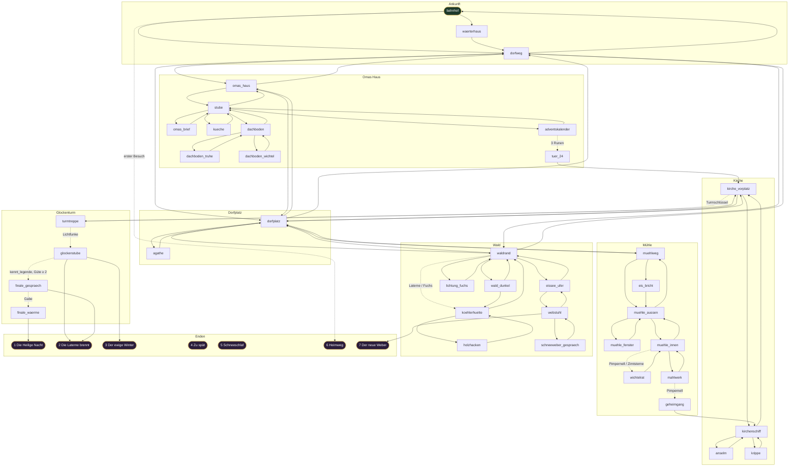

# Stationsgraph

Dieses Dokument beschreibt den gerichteten Spielgraphen von *Advent-ure: Die vierundzwanzigste Tür*: alle Stationen, Wahlmöglichkeiten, Bedingungen, Effekte und globalen Regeln. Es ist die fachliche Vorlage für die Spieldaten (`data/`), siehe [UMSETZUNGSPLAN.md](UMSETZUNGSPLAN.md). Story und Figuren stehen in [STORY.md](STORY.md).

---

## 1. Begriffe

| Begriff | Bedeutung |
|---|---|
| **Station** | Ein Knoten im Graphen. Sie hat eine ID, einen Titel, einen Text (eventuell mit zustandsabhängigen Varianten), einen Bereich, ein Klima und eine Liste von Wahlmöglichkeiten. |
| **Wahl** | Eine gerichtete Kante zu einer Zielstation. Sie kann eine **Bedingung** haben (sonst wird sie ausgeblendet oder ausgegraut) und **Effekte** auslösen. |
| **Aktion (↺)** | Eine Wahl, deren Ziel die aktuelle Station ist. Sie dient für Dinge wie „Tee trinken“ oder „Lebkuchen nehmen“. Aktionen sind standardmäßig **einmalig** und verschwinden nach der Benutzung, es sei denn, sie sind als *wiederholbar* markiert. |
| **Ende** | Eine Station ohne Wahlmöglichkeiten. Sie zeigt den Endtext und bietet „Neues Spiel“ und „Zum Erinnerungskalender“ an. |
| **Min** | Zeitkosten einer Wahl in Minuten. |

---

## 2. Spielzustand

### 2.1 Attribute

| ID | Name | Startwert | Bereich | Bedeutung |
|---|---|---|---|---|
| `zeit` | Uhrzeit | 0 | 0–180+ | Minuten seit 21:00 Uhr. Bei 180 ist Mitternacht. |
| `waerme` | Wärme | 7 | 0–10 | Körperwärme. Bei 0 kommt **Ende 5** (Schneeschlaf). |
| `guete` | Güte | 0 | −5 bis +12 | Wie viel Wärme du verschenkt hast. Wird für bestimmte Dialoge gebraucht. Im UI ist sie unsichtbar, sie erscheint nur indirekt in den Texten. |

### 2.2 Gegenstände (Manteltaschen)

| ID | Name | Quelle(n) | Verwendung | Verbrauchbar |
|---|---|---|---|---|
| `laterne` | Sturmlaterne | `waerterhaus` (Gustav), `dachboden_truhe` | Damit trägst du Flammen und gehst sicher durch den dunklen Wald. | nein |
| `streichhoelzer` | Streichhölzer | `kueche` | Kachelofen und Maronenofen anzünden | nein |
| `lebkuchen` | Lebkuchen (×3) | `kueche` | Verschenken (Pimpernell, Agathe, Fuchs, Schneeweber) oder **essen** (+1 Wärme) | ja |
| `zimtsterne` | Zimtsterne | `kueche` | Den Wichteln schenken | ja |
| `omas_brief` | Omas Brief | `omas_brief` | Anselm zeigen | nein |
| `schal` | Großvaters Wollschal | `dachboden_truhe` | Kälteschutz; kann an Agathe oder den Schneeweber verschenkt werden | ja |
| `spieldose_kaputt` | Stumme Spieldose | `dachboden_truhe` | Von den Wichteln reparieren lassen | wird ersetzt |
| `spieldose` | Omas Spieldose | `wichtelrat` | Rune **Klang**; Finale | nein |
| `silberglocke` | Silberglöckchen | `wichtelrat` | Rune **Klang**; kann Anselm zurückgegeben werden | ja |
| `maronen` | Heiße Maronen | `agathe` | **Essen**: +2 Wärme | ja |
| `strohstern` | Strohstern | `agathe`, `wichtelrat` | Rune **Herz** | nein |
| `kirchenflamme` | Flamme des Ewigen Lichts | `kirchenschiff` | Rune **Flamme**; Mühlrad auftauen | nein |
| `glut` | Köhlerglut | `koehlerhuette` | Rune **Flamme**; Mühlrad auftauen | nein |
| `turmschluessel` | Turmschlüssel | `anselm` | Öffnet die Turmtür | nein |
| `lichtfunke` | Der Lichtfunke | `tuer_24` | Finale. Wärmt dich zusätzlich, wie ein zweiter Schal. | nein |

Verbrauchbare Gegenstände (`lebkuchen`, `maronen`) haben im Inventar die Aktion **„Essen“**. Das kostet keine Zeit und ist jederzeit möglich, außer auf Endstationen.

### 2.3 Flags

| Flag | Gesetzt in | Bedeutung |
|---|---|---|
| `zug_abgefahren` | Verlassen von `bahnhof` | „Zurück in den Zug“ ist nicht mehr möglich. |
| `tee_getrunken` | `waerterhaus` | |
| `laterne_von_gustav` | `waerterhaus` | Für eine Epilog-Variante. |
| `brief_gelesen` | `omas_brief` | |
| `ofen_an` | `stube` | Die Stube ist warm, Text-Varianten. |
| `pimpernell_freund` | `dachboden_wichtel` | Öffnet den Wichtelrat und den Geheimgang. |
| `pimpernell_verscheucht` | `dachboden_wichtel` | |
| `legende_agathe` | `agathe` | Kennt die Legende des Schneewebers. |
| `agathe_ofen` | `agathe` | |
| `agathe_beschenkt` | `agathe` | |
| `schal_verschenkt` | `agathe` | Für eine Epilog-Variante. |
| `anselm_erlaubnis` | `anselm` | Darf eine Flamme vom Ewigen Licht nehmen. |
| `anselm_sorge` | `anselm` | Weiß vom fehlenden Silberglöckchen. |
| `flamme_gestohlen` | `kirchenschiff` | |
| `wichtel_beobachtet` | `muehle_fenster` | Text-Varianten im Wichtelrat. |
| `zimtsterne_geschenkt` | `muehle_innen` | Öffnet den Wichtelrat, Strohstern-Quelle. |
| `muehle_frei` | `wichtelrat` | |
| `fuchs_freund` | `lichtung_fuchs` | Der Fuchs führt dich durch den dunklen Wald. |
| `legende_ruprecht` | `koehlerhuette` | Kennt die Legende des Schneewebers. |
| `holz_gehackt` | `holzhacken` | |
| `korb_gefunden` | `eissee_ufer` | |
| `schneeweber_getroffen` | `webstuhl` | |
| `schneeweber_verstanden` | `schneeweber_gespraech` | Kennt die Legende des Schneewebers. |
| `schneeweber_gereizt` | `webstuhl` | Text-Variante im Finale. |
| `rune_flamme`, `rune_klang`, `rune_herz` | `adventskalender` | Die drei Siegel sind getaut. |
| `laterne_brennt` | Finale | Die Sternlaterne brennt. Verhindert Ende 4. |

**Abgeleitete Bedingung** `kennt_legende` := `legende_agathe` ODER `legende_ruprecht` ODER `schneeweber_verstanden`.

---

## 3. Globale Regeln

Die Engine wertet diese Regeln nach **jeder** Wahl in der angegebenen Reihenfolge aus.

1. **Effekte der Wahl anwenden:** Gegenstände, Flags, Attribute und `zeit += Min`.
2. **Kälte:** Wenn `Min > 0` ist und die Zielstation das Klima `kalt` oder `eisig` hat, sinkt die Wärme um 1 (`kalt`) bzw. 2 (`eisig`). `schal` und `lichtfunke` mindern den Verlust um je 1, er wird aber nie negativ. Bei Klima `warm` und `mild` ändert sich nichts.
3. **Ist die Zielstation ein Ende,** wird sie angezeigt, und die Regeln 4 und 5 entfallen.
4. **Schneeschlaf:** Bei `waerme <= 0` geht es zu `ende_schneeschlaf`.
5. **Mitternacht:** Bei `zeit >= 180` ohne `laterne_brennt` geht es zu `ende_zu_spaet`.
6. **Kirchturmuhr:** Überschreitet `zeit` eine Viertelstunde, erscheint eine Zeile über dem Stationstext, z. B. *„Vom Kirchturm schlägt es dreiviertel elf.“* Ab 23:30 werden diese Hinweise drängender.
7. **Autosave** im Local Storage.

**Klimastufen der Stationen:** `warm` (Wärterhaus, Köhlerhütte), `mild` (Innenräume), `kalt` (Wege, Plätze, Dachboden), `eisig` (Mühle außen, Eissee, dunkler Wald, Glockenstube).

---

## 4. Übersichtsgraph

Durchgezogene Pfeile sind freie Wege. Gestrichelte Pfeile haben eine Bedingung. Aktionen (↺) sind nicht eingezeichnet.

`ende_zu_spaet` und `ende_schneeschlaf` werden über die globalen Regeln erreicht, von jeder Station aus.

---

## 5. Stationen im Detail

Legende für die Tabellen: **Ziel ↺** = Aktion (bleibt auf der Station), *einmalig*, wenn nicht anders angegeben. Bedingungen ohne Erfüllung blenden die Wahl aus. Ausnahme sind Wahlen mit **(sichtbar)**: Sie werden ausgegraut mit Hinweis angezeigt, damit der Spieler weiß, dass es hier noch etwas gibt.

### Bereich A – Ankunft

#### A1 `bahnhof` – Der Bahnhof · *kalt* · **Start**
Der Zug hält, Schnee fällt, niemand holt dich ab. Im Wärterhäuschen brennt Licht, der Kirchturm im Tal ist dunkel.
*Variante bei `zug_abgefahren`:* Die Gleise sind verschneit, der Zug ist längst fort.

| Wahl | Ziel | Min | Bedingung | Effekte |
|---|---|---|---|---|
| An die Tür des Wärterhäuschens klopfen | `waerterhaus` | 0 | – | `zug_abgefahren` |
| Dem Pfad ins Dorf folgen | `dorfweg` | 10 | – | `zug_abgefahren` |
| Zurück in den warmen Zug steigen | `ende_heimweg` | 0 | ¬`zug_abgefahren` | – |

#### A2 `waerterhaus` – Gustavs Wärterhäuschen · *warm*
Ein kleiner Ofen bullert, und es riecht nach Kräutertee und Kohle. Gustav sagt, Oma sei am Nachmittag mit leerem Korb Richtung Wald gegangen.

| Wahl | Ziel | Min | Bedingung | Effekte |
|---|---|---|---|---|
| Einen Becher Tee annehmen | ↺ | 5 | – | Wärme +2, `tee_getrunken` |
| Um die Sturmlaterne bitten | ↺ | 0 | ¬`laterne` | +`laterne`, `laterne_von_gustav` |
| Hinaus und hinunter ins Dorf | `dorfweg` | 10 | – | – |

#### A3 `dorfweg` – Der Weg hinab · *kalt*
Zwischen verschneiten Tannen führt der Weg ins Tal. Im Schnee siehst du zwei Spuren: kleine Stiefelabdrücke und Abdrücke aus Eiskristallen, die beide zum Wald führen.

| Wahl | Ziel | Min | Bedingung | Effekte |
|---|---|---|---|---|
| Zu Omas Haus am Dorfrand | `omas_haus` | 10 | – | – |
| Hinunter zum Dorfplatz | `dorfplatz` | 10 | – | – |
| Den Spuren in den Wald folgen | `waldrand` | 15 | – | – |
| Zurück zum Bahnhof | `bahnhof` | 10 | – | – |

---

### Bereich B – Omas Haus

#### B1 `omas_haus` – Vor Omas Haus · *kalt*
Ein Tannenkranz hängt an der Tür, die nur angelehnt ist. Auf der Schwelle glitzern Frostblumen.

| Wahl | Ziel | Min | Bedingung | Effekte |
|---|---|---|---|---|
| Eintreten | `stube` | 0 | – | – |
| Zum Dorfplatz | `dorfplatz` | 5 | – | – |
| Den Weg zum Bahnhof hinauf | `dorfweg` | 10 | – | – |

#### B2 `stube` – Die Stube · *mild*
Ein kalter Kachelofen, der Tisch ist für zwei gedeckt. An der Wand hängt der Adventskalender, auf dem Tisch liegt ein Brief.
*Varianten:* bei `ofen_an` knistert es warm; bei `rune_*` glimmt der Kalender.

| Wahl | Ziel | Min | Bedingung | Effekte |
|---|---|---|---|---|
| Den Kachelofen anheizen | ↺ | 5 | `streichhoelzer`, ¬`ofen_an` **(sichtbar)** | `ofen_an`, Wärme +3 |
| Am Kachelofen aufwärmen *(wiederholbar)* | ↺ | 5 | `ofen_an` | Wärme +2 |
| Den Brief auf dem Tisch lesen | `omas_brief` | 0 | – | – |
| Den Adventskalender betrachten | `adventskalender` | 0 | – | – |
| In die Küche | `kueche` | 0 | – | – |
| Die Stiege zum Dachboden hinauf | `dachboden` | 0 | – | – |
| Hinaus vor das Haus | `omas_haus` | 0 | – | – |

#### B3 `omas_brief` – Omas Brief · *mild*
Der volle Brieftext steht in STORY.md. Er erklärt die drei Runen.

| Wahl | Ziel | Min | Bedingung | Effekte |
|---|---|---|---|---|
| Den Brief einstecken | `stube` | 5 | – | +`omas_brief`, `brief_gelesen` |

#### B4 `kueche` – Omas Küche · *mild*
Es riecht nach Zimt und Nelken. Auf dem Herd steht eine blaue Blechdose, daneben ein Teller Zimtsterne.

| Wahl | Ziel | Min | Bedingung | Effekte |
|---|---|---|---|---|
| Die Streichhölzer vom Sims nehmen | ↺ | 0 | – | +`streichhoelzer` |
| Lebkuchen aus der blauen Dose nehmen | ↺ | 0 | – | +`lebkuchen` ×3 |
| Die Zimtsterne einpacken | ↺ | 0 | – | +`zimtsterne` |
| Milch auf dem Herd wärmen und trinken | ↺ | 5 | `ofen_an` **(sichtbar)** | Wärme +2 |
| Zurück in die Stube | `stube` | 0 | – | – |

#### B5 `dachboden` – Der Dachboden · *kalt*
Staub, Spinnweben und Mondlicht durch eine Dachluke. Eine alte Truhe steht hier, und aus einer Ecke kommt ein Rascheln.

| Wahl | Ziel | Min | Bedingung | Effekte |
|---|---|---|---|---|
| Die alte Truhe öffnen | `dachboden_truhe` | 0 | – | – |
| Dem Rascheln nachgehen | `dachboden_wichtel` | 0 | ¬`pimpernell_freund`, ¬`pimpernell_verscheucht` | – |
| Hinunter in die Stube | `stube` | 0 | – | – |

#### B6 `dachboden_truhe` – Großvaters Truhe · *kalt*
Mottenkugeln, alte Briefe und darunter ein Schal, eine Spieldose und eine Stalllaterne.

| Wahl | Ziel | Min | Bedingung | Effekte |
|---|---|---|---|---|
| Den Wollschal umlegen | ↺ | 0 | – | +`schal` |
| Die Spieldose mitnehmen | ↺ | 0 | – | +`spieldose_kaputt` |
| Die Stalllaterne nehmen | ↺ | 0 | ¬`laterne` | +`laterne` |
| Die Truhe schließen | `dachboden` | 0 | – | – |

#### B7 `dachboden_wichtel` – Pimpernell · *kalt*
Hinter einem Hutkarton zittert ein Wichtel mit roter Zipfelmütze. Er ist vor dem Frost aus der Mühle geflohen und hat großen Hunger.

| Wahl | Ziel | Min | Bedingung | Effekte |
|---|---|---|---|---|
| Ihm einen Lebkuchen schenken | `dachboden` | 0 | `lebkuchen` **(sichtbar)** | −`lebkuchen`, Güte +1, `pimpernell_freund` |
| „Husch, verschwinde!“ | `dachboden` | 0 | – | Güte −1, `pimpernell_verscheucht` |
| Dich leise zurückziehen | `dachboden` | 0 | – | – |

#### B8 `adventskalender` – Der Adventskalender · *mild*
Das Eissiegel mit den drei Runen. Der Text zeigt, welche Runen schon getaut sind.

| Wahl | Ziel | Min | Bedingung | Effekte |
|---|---|---|---|---|
| Die Flammenrune mit der Kirchenflamme tauen | ↺ | 5 | `kirchenflamme`, ¬`rune_flamme` | `rune_flamme` |
| Die Flammenrune mit der Köhlerglut tauen | ↺ | 5 | `glut`, ¬`rune_flamme` | `rune_flamme` |
| Die Spieldose am Siegel spielen | ↺ | 5 | `spieldose`, ¬`rune_klang` | `rune_klang` |
| Das Silberglöckchen läuten | ↺ | 5 | `silberglocke`, ¬`rune_klang` | `rune_klang` |
| Den Strohstern auf die Herzrune legen | ↺ | 5 | `strohstern`, ¬`rune_herz` | `rune_herz` |
| Die vierundzwanzigste Tür öffnen | `tuer_24` | 0 | `rune_flamme`, `rune_klang`, `rune_herz` | – |
| Zurück in die Stube | `stube` | 0 | – | – |

#### B9 `tuer_24` – Die vierundzwanzigste Tür · *mild*
Der Lichtfunke schwebt heraus, und in seinem Licht siehst du eine Vision: Der Schneeweber trägt Oma in einem Kokon aus Schnee den Glockenturm hinauf.

| Wahl | Ziel | Min | Bedingung | Effekte |
|---|---|---|---|---|
| Den Funken in die Laterne setzen und zur Kirche eilen | `kirche_vorplatz` | 10 | – | +`lichtfunke` |

---

### Bereich C – Dorfplatz

#### C1 `dorfplatz` – Der Dorfplatz · *kalt*
Die Buden des Weihnachtsmarkts sind verlassen, der Christbaum ist dunkel, und aus dem Brunnen ragen Eiszapfen wie Hände. Am Rand sitzt eine alte Frau an einem erkalteten Maronenofen.

| Wahl | Ziel | Min | Bedingung | Effekte |
|---|---|---|---|---|
| Zu der alten Frau gehen | `agathe` | 0 | – | – |
| Zur Kirche | `kirche_vorplatz` | 5 | – | – |
| Den Bachweg hinauf zur Mühle | `muehlweg` | 10 | – | – |
| Hinaus zum Waldrand | `waldrand` | 15 | – | – |
| Zu Omas Haus | `omas_haus` | 5 | – | – |
| Den Weg zum Bahnhof hinauf | `dorfweg` | 10 | – | – |

#### C2 `agathe` – Die Maronenfrau · *kalt*
Agathe, in drei Tücher gewickelt, die Finger blau vor Kälte. Sie kennt die alten Geschichten.

| Wahl | Ziel | Min | Bedingung | Effekte |
|---|---|---|---|---|
| Nach dem Schneeweber fragen | ↺ | 5 | – | `legende_agathe` |
| Ihren Maronenofen anzünden | ↺ | 5 | `streichhoelzer` **(sichtbar)** | `agathe_ofen`, Wärme +1, +`maronen` |
| Ihr einen Lebkuchen schenken | ↺ | 0 | `lebkuchen`, ¬`agathe_beschenkt` | −`lebkuchen`, Güte +1, `agathe_beschenkt`, +`strohstern` |
| Ihr deinen Schal umlegen | ↺ | 0 | `schal`, ¬`schal_verschenkt` | −`schal`, Güte +2, `schal_verschenkt`, `agathe_beschenkt`, +`strohstern` (falls noch nicht vorhanden) |
| Zurück auf den Platz | `dorfplatz` | 0 | – | – |

*Hinweis:* Agathe darf nie nach einer Gegenleistung gefragt werden. Der Strohstern kommt als Überraschung, und darum geht es bei der Herzrune.

---

### Bereich D – Kirche

#### D1 `kirche_vorplatz` – Vor der Kirche · *kalt*
Verschneite Gräber, das Kirchenportal. Am Turm kriecht Eis wie gewebte Spitze nach oben. Die Turmtür ist mit einem schweren Schloss gesichert.
*Variante bei `lichtfunke`:* Das Eis am Turm knistert, als ob es den Funken spürt.

| Wahl | Ziel | Min | Bedingung | Effekte |
|---|---|---|---|---|
| Die Kirche betreten | `kirchenschiff` | 0 | – | – |
| Die Turmtür aufschließen | `turmtreppe` | 0 | `turmschluessel` **(sichtbar)** | – |
| Zurück zum Dorfplatz | `dorfplatz` | 5 | – | – |

#### D2 `kirchenschiff` – Im Kirchenschiff · *mild*
Kerzen, Weihrauch und die Krippe. Das Ewige Licht flackert rot. Ein alter Mann kniet vor dem Altar.

| Wahl | Ziel | Min | Bedingung | Effekte |
|---|---|---|---|---|
| Den Küster ansprechen | `anselm` | 0 | – | – |
| Die Krippe betrachten | `krippe` | 0 | – | – |
| Eine Flamme vom Ewigen Licht nehmen | ↺ | 0 | `laterne`, `anselm_erlaubnis`, ¬`kirchenflamme` | +`kirchenflamme` |
| Heimlich eine Flamme stehlen | ↺ | 0 | `laterne`, ¬`anselm_erlaubnis`, ¬`kirchenflamme` | +`kirchenflamme`, Güte −2, `flamme_gestohlen` |
| Hinaus auf den Vorplatz | `kirche_vorplatz` | 0 | – | – |

#### D3 `anselm` – Küster Anselm · *mild*
Er hat Sorgen: Die Glocke ist eingefroren, die Laterne ist dunkel, und aus der Krippe fehlt das Silberglöckchen.

| Wahl | Ziel | Min | Bedingung | Effekte |
|---|---|---|---|---|
| Fragen, was ihn bedrückt | ↺ | 0 | – | `anselm_sorge` |
| Ihm Omas Brief zeigen | ↺ | 0 | `omas_brief` | `anselm_erlaubnis` |
| Ihm den Lichtfunken zeigen | ↺ | 0 | `lichtfunke` | +`turmschluessel` |
| Ihm das Silberglöckchen zurückgeben | ↺ | 0 | `silberglocke`, `rune_klang` | −`silberglocke`, Güte +2 |
| Zurück ins Kirchenschiff | `kirchenschiff` | 0 | – | – |

#### D4 `krippe` – Die Krippe · *mild*
Geschnitzte Figuren. Das Christkind hält die Hand leer ausgestreckt. Im Stroh sind winzige Fußspuren zu sehen.

| Wahl | Ziel | Min | Bedingung | Effekte |
|---|---|---|---|---|
| Zurück ins Kirchenschiff | `kirchenschiff` | 0 | – | – |

---

### Bereich E – Die alte Mühle

#### E1 `muehlweg` – Am gefrorenen Bach · *kalt*
Weiden, die sich unter dem Eis biegen. Der Weg macht einen weiten Bogen, quer über das Eis wäre es kürzer.

| Wahl | Ziel | Min | Bedingung | Effekte |
|---|---|---|---|---|
| Dem Weg zur Mühle folgen | `muehle_aussen` | 10 | – | – |
| Über das Eis abkürzen | `eis_bricht` | 5 | – | – |
| Zurück zum Dorfplatz | `dorfplatz` | 10 | – | – |

#### E2 `eis_bricht` – Kalte Füße · *eisig*
Es kracht, und du brichst bis zu den Knien ein.

| Wahl | Ziel | Min | Bedingung | Effekte |
|---|---|---|---|---|
| Dich triefend ans Ufer retten | `muehle_aussen` | 0 | – | Wärme −3 |

#### E3 `muehle_aussen` – Die alte Mühle · *eisig*
Das Mühlrad steckt in einem Panzer aus kunstvoll gewebtem Eis. Hinter den Fenstern huschen kleine Lichter.

| Wahl | Ziel | Min | Bedingung | Effekte |
|---|---|---|---|---|
| Durch die knarrende Tür hinein | `muehle_innen` | 0 | – | – |
| Durch das Fensterchen spähen | `muehle_fenster` | 0 | – | – |
| Zurück zum Bach | `muehlweg` | 10 | – | – |

#### E4 `muehle_fenster` – Ein Blick hinein · *eisig*
Ein Wichtelrat sitzt um ein Silberglöckchen. „Solange es klingt, kommt der Frost nicht herein!“

| Wahl | Ziel | Min | Bedingung | Effekte |
|---|---|---|---|---|
| Dich vom Fenster lösen | `muehle_aussen` | 0 | – | `wichtel_beobachtet` |

#### E5 `muehle_innen` – In der Mühle · *mild*
Es ist mehlig und still, und alle Lichter sind erloschen. Du spürst, dass dich viele kleine Augen beobachten.
*Variante bei `pimpernell_freund`:* Pimpernell taucht auf und ruft: „Das ist ein Freund!“

| Wahl | Ziel | Min | Bedingung | Effekte |
|---|---|---|---|---|
| Zimtsterne auf den Mühlstein legen | ↺ | 0 | `zimtsterne` | −`zimtsterne`, Güte +1, `zimtsterne_geschenkt` |
| „Hallo? Ist da jemand?“ rufen | ↺ | 0 | – | Text: Mehlregen von oben, sonst nichts. |
| Dem Wichtelrat vorgestellt werden | `wichtelrat` | 0 | `pimpernell_freund` ODER `zimtsterne_geschenkt` | – |
| Das Mahlwerk untersuchen | `mahlwerk` | 0 | – | – |
| Hinaus | `muehle_aussen` | 0 | – | – |

#### E6 `wichtelrat` – Der Wichtelrat · *mild*
Großvater Haselbart thront auf einem Mehlsack. Die Wichtel lieben Musik und Süßes und haben große Angst vor dem Frost.

| Wahl | Ziel | Min | Bedingung | Effekte |
|---|---|---|---|---|
| Um Reparatur der Spieldose bitten | ↺ | 10 | `spieldose_kaputt` | −`spieldose_kaputt`, +`spieldose` |
| Nach dem Silberglöckchen fragen | ↺ | 0 | ¬`muehle_frei` | Text: „Erst, wenn das Mühlrad frei ist.“ |
| Das Mühlrad mit deiner Flamme befreien | ↺ | 5 | (`kirchenflamme` ODER `glut`), ¬`muehle_frei` **(sichtbar)** | `muehle_frei`, Güte +1, +`silberglocke` |
| Um einen Strohstern bitten | ↺ | 0 | `zimtsterne_geschenkt`, ¬`strohstern` | +`strohstern` |
| Dich verabschieden | `muehle_innen` | 0 | – | – |

#### E7 `mahlwerk` – Das Mahlwerk · *mild*
Riesige Zahnräder und darunter eine Falltür im Boden.
*Variante bei `pimpernell_freund`:* „Da unten geht's zur Kirche“, flüstert Pimpernell, „das ist der alte Mehlweg der Mönche.“

| Wahl | Ziel | Min | Bedingung | Effekte |
|---|---|---|---|---|
| Pimpernell durch die Falltür folgen | `geheimgang` | 0 | `pimpernell_freund` | – |
| Zurück | `muehle_innen` | 0 | – | – |

#### E8 `geheimgang` – Der Mehlweg · *mild*
Ein niedriger Gang, Wurzeln an der Decke und Pimpernells Laternchen vor dir.

| Wahl | Ziel | Min | Bedingung | Effekte |
|---|---|---|---|---|
| Durch die Klappe hinter dem Altar steigen | `kirchenschiff` | 5 | – | – |

---

### Bereich F – Der Wald

#### F1 `waldrand` – Am Waldrand · *kalt*
Drei Wege: Rauchgeruch aus der Tiefe des Waldes, ein Wimmern von einer Lichtung und ein Glitzern zwischen den Stämmen, wo der Eissee liegt.

| Wahl | Ziel | Min | Bedingung | Effekte |
|---|---|---|---|---|
| Mit der Laterne dem Rauchgeruch folgen | `koehlerhuette` | 10 | `laterne` | – |
| Dem Fuchs folgen, der vorausläuft | `koehlerhuette` | 10 | `fuchs_freund`, ¬`laterne` | – |
| Im Dunkeln dem Rauchgeruch folgen | `wald_dunkel` | 10 | ¬`laterne`, ¬`fuchs_freund` | – |
| Dem Wimmern nachgehen | `lichtung_fuchs` | 5 | ¬`fuchs_freund` | – |
| Zum glitzernden Eissee | `eissee_ufer` | 10 | – | – |
| Zurück zum Dorfplatz | `dorfplatz` | 15 | – | – |
| Zum Weg Richtung Bahnhof | `dorfweg` | 15 | – | – |

#### F2 `wald_dunkel` – Im dunklen Wald · *eisig*
Stämme, Schwärze und Schnee bis zu den Knien. Irgendwo in der Ferne glimmt etwas Rotes.

| Wahl | Ziel | Min | Bedingung | Effekte |
|---|---|---|---|---|
| Auf das rote Glimmen zustapfen | `koehlerhuette` | 15 | – | – |
| Umkehren | `waldrand` | 10 | – | – |

#### F3 `lichtung_fuchs` – Die Lichtung · *kalt*
Ein roter Fuchs hängt mit der Pfote in einer alten Drahtschlinge. Um ihn herum ist der Schnee zu Frostmustern gewoben.

| Wahl | Ziel | Min | Bedingung | Effekte |
|---|---|---|---|---|
| Die Schlinge vorsichtig lösen | ↺ | 5 | – | Güte +1, `fuchs_freund` |
| Ihm einen Lebkuchen hinlegen | ↺ | 0 | `lebkuchen` | −`lebkuchen`, Güte +1 |
| Zurück zum Waldrand | `waldrand` | 5 | – | – |

#### F4 `koehlerhuette` – Ruprechts Köhlerhütte · *warm*
Der Meiler raucht, und ein Feuer prasselt. Ruprecht, groß wie ein Bär, mustert dich schweigend.

| Wahl | Ziel | Min | Bedingung | Effekte |
|---|---|---|---|---|
| Dich am Feuer aufwärmen | ↺ | 5 | – | Wärme +3 |
| Nach dem Schneeweber fragen | ↺ | 5 | – | `legende_ruprecht` |
| Um Glut aus dem Meiler bitten | ↺ | 0 | `laterne`, (Güte ≥ 2 ODER `holz_gehackt`), ¬`glut` | +`glut` |
| Um Glut bitten (er lehnt ab) | ↺ | 0 | `laterne`, Güte < 2, ¬`holz_gehackt` | Text: „Glut ist kein Geschenk für Fremde. Aber Holz hacken könnt' ich Hilfe brauchen.“ |
| Ihm beim Holzhacken helfen | `holzhacken` | 0 | ¬`holz_gehackt` | – |
| Zurück zum Waldrand | `waldrand` | 10 | – | – |

#### F5 `holzhacken` – Holz für den Winter · *kalt*
Axtschläge, Schweiß trotz der Kälte, und Ruprecht brummt zufrieden.

| Wahl | Ziel | Min | Bedingung | Effekte |
|---|---|---|---|---|
| Die Axt zurückgeben | `koehlerhuette` | 20 | – | `holz_gehackt`, Güte +1, Wärme +1 |

#### F6 `eissee_ufer` – Am Eissee · *eisig*
Der See ist ein schwarzer Spiegel. In seiner Mitte steht ein Webstuhl aus Eis und Mondlicht. Am Ufer liegt Omas Korb.

| Wahl | Ziel | Min | Bedingung | Effekte |
|---|---|---|---|---|
| Omas Korb untersuchen | ↺ | 0 | – | `korb_gefunden`, Text: ein Wollfaden führt übers Eis |
| Über das Eis zum Webstuhl gehen | `webstuhl` | 5 | – | Wärme −1 (zusätzlich) |
| Zurück zum Waldrand | `waldrand` | 10 | – | – |

#### F7 `webstuhl` – Der Webstuhl des Schneewebers · *eisig*
*Erster Besuch:* Der Schneeweber selbst, hoch und durchscheinend. Oma ist als Gestalt in einen Teppich aus Schnee eingewoben.
*Bei `schneeweber_getroffen`:* Der Webstuhl ist verlassen, die Fäden hängen lose, und er ist zum Turm gegangen.

| Wahl | Ziel | Min | Bedingung | Effekte |
|---|---|---|---|---|
| Ihn fragen, warum er das tut | `schneeweber_gespraech` | 0 | ¬`schneeweber_getroffen` | `schneeweber_getroffen` |
| Anbieten, Omas Platz einzunehmen | `ende_schneeweber` | 0 | ¬`schneeweber_getroffen`, `korb_gefunden` | – |
| Die Flamme gegen ihn erheben | `eissee_ufer` | 0 | (`kirchenflamme` ODER `glut`), ¬`schneeweber_getroffen` | `schneeweber_getroffen`, `schneeweber_gereizt` |
| Fliehen | `eissee_ufer` | 5 | ¬`schneeweber_getroffen` | `schneeweber_getroffen`, Wärme −1 |
| Zurück ans Ufer | `eissee_ufer` | 5 | `schneeweber_getroffen` | – |

#### F8 `schneeweber_gespraech` – Tausend Winter · *eisig*
Er erzählt, dass er jede Flocke gewebt hat und keine je gedankt wurde. Er will den Funken, um einmal Wärme zu fühlen. „Wir sehen uns um Mitternacht. Am Turm.“

| Wahl | Ziel | Min | Bedingung | Effekte |
|---|---|---|---|---|
| Schweigend nicken | `webstuhl` | 5 | – | `schneeweber_verstanden`, Güte +1 |

---

### Bereich G – Glockenturm (Finale)

#### G1 `turmtreppe` – Die Turmtreppe · *kalt*
Dreihundert Stufen. Je höher du steigst, desto dicker wird das Eis.

| Wahl | Ziel | Min | Bedingung | Effekte |
|---|---|---|---|---|
| Mit dem Lichtfunken hinaufsteigen | `glockenstube` | 10 | `lichtfunke` **(sichtbar)** | – |
| Umkehren | `kirche_vorplatz` | 0 | – | – |

#### G2 `glockenstube` – In der Glockenstube · *eisig*
Die große Glocke steckt in Eis. Neben der dunklen Sternlaterne steht der Schneeweber, und zu seinen Füßen schläft Oma in einem Kokon aus Schnee.
*Variante bei `schneeweber_gereizt`:* Er weicht vor deiner Laterne zurück und ist misstrauisch.
*Variante bei Wärme ≤ 2:* Deine Hände zittern so sehr, dass der Funke flackert.

| Wahl | Ziel | Min | Bedingung | Effekte |
|---|---|---|---|---|
| Den Lichtfunken in die Sternlaterne setzen | `ende_laterne` | 0 | – | `laterne_brennt` |
| Mit dem Schneeweber sprechen | `finale_gespraech` | 0 | `kennt_legende`, Güte ≥ 2 | – |
| Ihm den Lichtfunken geben | `ende_ewiger_winter` | 0 | – | – |

#### G3 `finale_gespraech` – Ein Wort im Frost · *eisig*
„Nur ein einziges Mal wollte ich wissen, wie sich Wärme anfühlt.“

| Wahl | Ziel | Min | Bedingung | Effekte |
|---|---|---|---|---|
| Ihm deinen Schal umlegen | `finale_waerme` | 0 | `schal` | −`schal` |
| Omas Spieldose für ihn spielen | `finale_waerme` | 0 | `spieldose` | – |
| Ihm einen Lebkuchen anbieten | `finale_waerme` | 0 | `lebkuchen` | −`lebkuchen` |
| „Deine Flocken sind das Schönste am Winter.“ | `finale_waerme` | 0 | Güte ≥ 4 | – |
| Doch den Funken in die Laterne setzen | `ende_laterne` | 0 | – | `laterne_brennt` |

#### G4 `finale_waerme` – Wärme · *mild*
Der Schneeweber hält inne. Der Kokon um Oma rieselt zu Boden, und sie schlägt die Augen auf. „Komm“, sagt sie und streckt die Hand aus, „das machen wir zusammen. Alle drei.“

| Wahl | Ziel | Min | Bedingung | Effekte |
|---|---|---|---|---|
| Gemeinsam die Sternlaterne entzünden | `ende_heilige_nacht` | 0 | – | `laterne_brennt` |

---

### Bereich X – Enden

| ID | Titel | Erreichbar über | Epilog-Varianten nach Flags |
|---|---|---|---|
| `ende_heilige_nacht` | Die Heilige Nacht | `finale_waerme` | `fuchs_freund`, `pimpernell_freund`, `schal_verschenkt`, `holz_gehackt`, `flamme_gestohlen`, `laterne_von_gustav` |
| `ende_laterne` | Die Laterne brennt | `glockenstube`, `finale_gespraech` | wie oben |
| `ende_ewiger_winter` | Der ewige Winter | `glockenstube` | – |
| `ende_zu_spaet` | Zu spät | global (Mitternacht) | `korb_gefunden` (Oma bekommt ihren Korb zurück) |
| `ende_schneeschlaf` | Schneeschlaf | global (Wärme 0) | `laterne_von_gustav` (Gustav fand dich wegen des Laternenscheins) |
| `ende_heimweg` | Heimweg | `bahnhof` | – |
| `ende_schneeweber` | Der neue Weber | `webstuhl` | `pimpernell_freund` (die Wichtel besuchen dich am See) |

---

## 6. Lösungsmatrix der drei Runen

| Rune | Weg 1 | Weg 2 |
|---|---|---|
| **Flamme** | `laterne` + `omas_brief` → Anselm erlaubt die `kirchenflamme` (oder sie wird gestohlen, Güte −2) | `laterne` + (Güte ≥ 2 oder Holzhacken, +20 min) → Ruprechts `glut` |
| **Klang** | `spieldose_kaputt` (Dachboden) → Reparatur im Wichtelrat (+10 min) | Flamme + Wichtelrat → Mühlrad befreien → `silberglocke` |
| **Herz** | `lebkuchen` oder `schal` an Agathe → `strohstern` | `zimtsterne` an die Wichtel → `strohstern` |

Zugang zum Wichtelrat: `pimpernell_freund` (1 Lebkuchen) **oder** `zimtsterne_geschenkt`.

---

## 7. Zeit- und Wärme-Budget (Erstschätzung)

**Schnellster Weg zum besten Ende ohne Wald:**
`bahnhof → waerterhaus` (Tee, Laterne) `→ dorfweg → omas_haus → stube` (Brief, Küche, Ofen, Dachboden: Schal, Spieldose, Pimpernell) `→ dorfplatz → agathe` (Legende, Lebkuchen, Strohstern) `→ muehlweg → muehle_aussen → muehle_innen → wichtelrat` (Spieldose) `→ mahlwerk → geheimgang → kirchenschiff → anselm` (Brief, Erlaubnis, Flamme) `→ dorfplatz → omas_haus → adventskalender` (3 Runen) `→ tuer_24 → kirche_vorplatz → anselm` (Schlüssel) `→ turmtreppe → glockenstube → finale_gespraech → finale_waerme → ende_heilige_nacht`

- **Zeit:** ca. 125 Minuten, also Ankunft im Turm gegen 23:05 Uhr.
- **Puffer:** ca. 55 Minuten. Ein vollständiger Waldausflug (Köhler und Eissee) kostet 70–90 Minuten. **Man schafft nicht alles in einem Durchgang.** Das ist gewollt und erhöht den Wiederspielwert.
- **Wärme ohne Schal:** Start 7, Wärmequellen auf dem Weg +9, Kälteverlust etwa −12. Das reicht knapp. Mit Schal bleibt es bequem.

Diese Werte werden in Meilenstein M7 (Balancing) mit dem Graph-Validator nachgerechnet, siehe UMSETZUNGSPLAN.md.

---

## 8. Prüfregeln für den Graphen

Der Validator (`tools/validate-graph`) muss sicherstellen:

1. Jede Ziel-ID einer Wahl existiert als Station.
2. Jede Station außer den Enden hat mindestens eine Wahl ohne Bedingung oder zumindest eine Wahl, die in jedem erreichbaren Zustand verfügbar ist. Es gibt also **keine Sackgassen**.
3. Jede Station ist vom Start `bahnhof` aus erreichbar.
4. Jedes Ende ist erreichbar. Die beiden globalen Enden werden über einen Zustandsraum-Test geprüft.
5. Jeder in einer Bedingung verwendete Gegenstand und jedes Flag wird irgendwo gesetzt bzw. vergeben.
6. **Softlock-Test:** Eine Zustandsraumsuche (BFS über Station plus abstrahierten Zustand) findet für jeden erreichbaren Zustand vor Mitternacht einen Pfad zu einem Ende. Das ist trivial erfüllt, weil Mitternacht immer zu einem Ende führt. Zusätzlich prüft der Test, ob das **beste Ende** aus allen Zuständen erreichbar bleibt, die vor 22:30 Uhr liegen und Wärme ≥ 4 haben. Dabei werden Gegenstände berücksichtigt, die nicht mehr zu bekommen sind.
